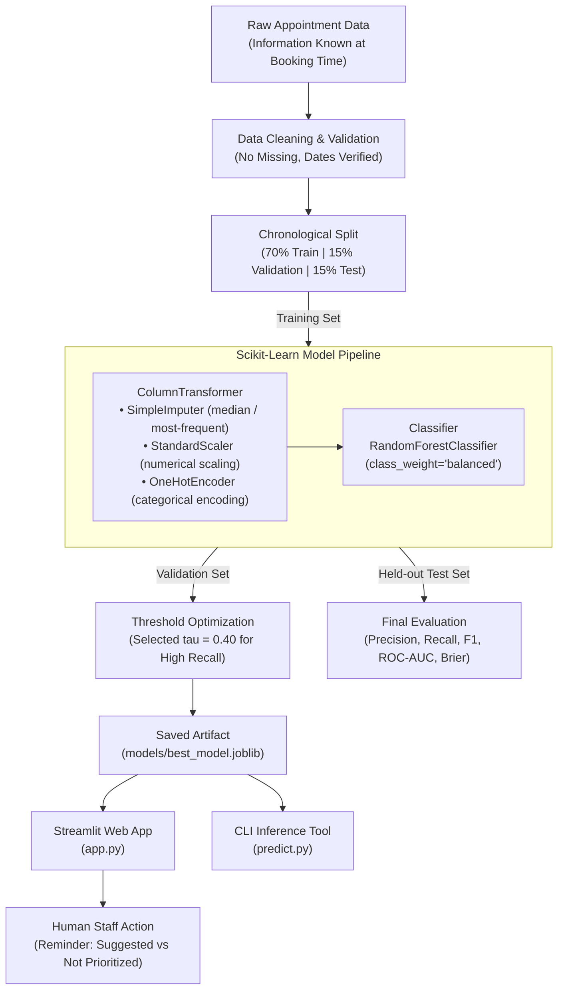

# 🏥 Hospital Appointment No-Show Prediction
### Machine Learning-Based Appointment Reminder Support System
**Internship Assessment:** ALGIONS AI LABS PRIVATE LIMITED  
**Role:** AI & Machine Learning Intern  
**Academic Level:** Final-Year B.Tech Computer Science & Engineering (Specialization: Data Science / Machine Learning)  

---

## 1. Problem Statement
In outpatient hospital clinics, missed appointments ("no-shows") cause serious operational problems:
- Doctors and high-cost medical equipment remain idle.
- Waiting lists for other sick patients become longer.
- Hospitals face revenue losses and scheduling chaos.

However, hospital receptionists cannot manually call every single booked patient every day. We need an intelligent way to identify which appointments have a high risk of being missed so staff can prioritize reminder calls.

---

## 2. Project Objective
Build an end-to-end Machine Learning decision-support application that predicts the probability of a patient missing their booked outpatient appointment.

**Critical Healthcare Boundary:**
This project is an administrative decision-support tool. It **does NOT** predict medical diagnoses, clinical urgency, triage tiers, or health outcomes. All suggested reminder calls must be reviewed and confirmed by human hospital staff.

---

## 3. System Architecture



---

## 4. Technologies Used
- **Language:** Python 3.13 / 3.10+
- **Data Analysis:** Pandas, NumPy
- **Machine Learning:** Scikit-Learn (ColumnTransformer, Pipeline, DummyClassifier, LogisticRegression, RandomForestClassifier)
- **Model Serialization:** Joblib
- **Data Visualization:** Matplotlib, Seaborn
- **User Interface:** Streamlit
- **Automated Testing:** Pytest

---

## 5. Dataset Explanation
To protect patient confidentiality (HIPAA/GDPR compliance), a reproducible synthetic dataset of **3,500 records** was created with fixed random seed `42`.

### Features Strictly Known at Booking Time:
| Column Name | Type | Description |
| :--- | :--- | :--- |
| `appointment_id` | String | Unique identifier (e.g. `APT-10001`, dropped from modeling) |
| `booking_date` | Date | Date when the appointment was booked |
| `appointment_date` | Date | Scheduled date of the clinic visit |
| `lead_time_days` | Integer | Days between booking and appointment ($appointment\_date - booking\_date$) |
| `age_group` | Category | Young Adults (18-35), Middle-Aged (36-55), Older Adults (56-70), Seniors (71+) |
| `department` | Category | General Medicine, Cardiology, Orthopedics, Dermatology, Pediatrics, Ophthalmology |
| `appointment_type` | Category | Routine Checkup, Follow-up, Specialist Consultation, Diagnostic / Lab |
| `booking_channel` | Category | Online Portal, Phone Call, In-Person, Mobile App |
| `previous_appointments` | Integer | Total appointments completed/scheduled prior to this booking |
| `previous_no_shows` | Integer | Prior missed visits before this booking ($\le previous\_appointments$) |
| `sms_opt_in` | Binary | 1 = Patient opted in for text alerts, 0 = No |
| `no_show` (Target) | Binary | 0 = Patient Attended (73%), 1 = Patient Missed Appointment (27%) |

---

## 6. Project Folder Structure

```
hospital-no-show-prediction/
│
├── app.py                     # Streamlit web application interface
├── generate_data.py           # Reproducible synthetic dataset generator (seed=42)
├── train_model.py             # Preprocessing, chronological splitting & training pipeline
├── evaluate_model.py          # Standalone evaluation & diagnostic chart generator
├── predict.py                 # Fast command-line inference tool for interviews
├── requirements.txt           # Python dependencies
├── README.md                  # Comprehensive project documentation
├── SUBMISSION_FORM.md         # Pre-filled internship submission form
├── .gitignore                 # Python gitignore rules
│
├── data/
│   └── appointments.csv       # 3,500 generated appointment records
│
├── models/
│   └── best_model.joblib      # Saved preprocessor + Random Forest pipeline & threshold
│
├── notebooks/
│   ├── eda.ipynb              # Interactive Jupyter Notebook for EDA
│   └── run_eda.py             # Script to generate EDA charts
│
├── reports/
│   ├── technical_report.md    # Formal academic technical report
│   ├── model_results.csv      # Benchmarked test and validation metrics
│   └── figures/               # 8 generated high-resolution diagnostic plots:
│       ├── 01_target_distribution.png
│       ├── 02_noshow_by_department.png
│       ├── 03_noshow_by_age_group.png
│       ├── 04_lead_time_vs_noshow.png
│       ├── 05_previous_noshows_vs_noshow.png
│       ├── 06_confusion_matrix.png
│       ├── 07_roc_curve.png
│       └── 08_calibration_curve.png
│
└── tests/
    └── test_pipeline.py       # 8 unit and integration tests passing with Pytest
```

---

## 7. Step-by-Step Execution Guide (Windows PowerShell)

Open Windows PowerShell in VS Code:

### Step 1: Navigate to Project Directory
```powershell
cd "D:\Aiml project\hospital-no-show-prediction"
```

### Step 2: Install Required Dependencies
```powershell
pip install -r requirements.txt
```

### Step 3: Run Automated Verification Tests
```powershell
pytest tests/test_pipeline.py -v
```
*(Expected: All 8 unit tests PASS)*

### Step 4: Launch the Streamlit Web Application
```powershell
streamlit run app.py
```
*Opens the web app in your browser at `http://localhost:8501`.*

### Step 5: (Bonus) Run Fast Prediction from Terminal
```powershell
python predict.py --lead_time 21 --prev_appts 3 --prev_noshows 2 --dept Dermatology
```

---

## 8. Actual Test Set Evaluation Results

Evaluated on the **Held-Out Test Set** (525 unseen future records: 380 attended, 145 missed):

| Model Name | Operating Threshold | Accuracy | Precision | Recall (Sensitivity) | F1-Score | ROC-AUC | Brier Score |
| :--- | :--- | :--- | :--- | :--- | :--- | :--- | :--- |
| **Dummy Baseline** | 0.50 | 72.4% | 0.0% | 0.0% | 0.0000 | 0.500 | 0.2000 |
| **Logistic Regression** | 0.50 | 64.0% | 40.3% | 62.8% | 0.4910 | **0.693** | 0.2252 |
| **Random Forest (Champion)** | **0.40** | 49.7% | 33.6% | **84.1%** | **0.4803** | 0.656 | **0.2206** |

### Confusion Matrix on Test Set (Random Forest, $\tau = 0.40$):
```
                       PREDICTED
                 Attended (0)    No-Show (1)
ACTUAL
Attended (0)      TN = 139        FP = 241
No-Show (1)       FN = 23         TP = 122
```
- **Total Missed Appointments:** 145
- **No-Shows Caught (TP):** **122 out of 145 (84.1% Recall!)**
- **No-Shows Missed (FN):** Only 23 missed appointments.

### Why We Selected Threshold $\tau = 0.40$:
In healthcare operations, the cost of a **False Negative** (a doctor waiting for 45 minutes for a patient who never arrives) is far greater than a **False Positive** (a receptionist making a 30-second reminder phone call). By tuning our decision threshold to 0.40 on validation data, our Recall jumped to **84.1%**, capturing **122 out of 145 no-shows**.

---

## 9. Streamlit Application Walkthrough
The web application provides three structured sections:
1. **Section A: Home / Overview:**
   - Displays project objective, clinical safety disclaimers, and system workflow.
2. **Section B: Prediction (Interactive Decision Support):**
   - Front-desk staff enter appointment dates and patient history.
   - Lead time is calculated automatically in real time.
   - System outputs the predicted probability (e.g. `67.9%`) and clear recommendation:
     - ⚠️ `Reminder Review: Suggested` (if $\ge 40\%$)
     - ✅ `Reminder Review: Not Prioritized` (if $< 40\%$)
   - Contextual signals explain why the score is high (e.g. long lead time, history of missed visits).
3. **Section C: Model Performance:**
   - Displays real benchmark tables, interactive confusion matrix, ROC curve, and operational error cost explanations.

---

## 10. Responsible AI & Governance
- **Advisory Only:** Predictions assist staff; the system never denies healthcare access or automatically cancels visits.
- **Fairness:** Sensitive demographic features like race, religion, and medical illnesses were deliberately excluded.
- **Human Oversight:** All suggested reminder actions require final review and confirmation by hospital staff.
