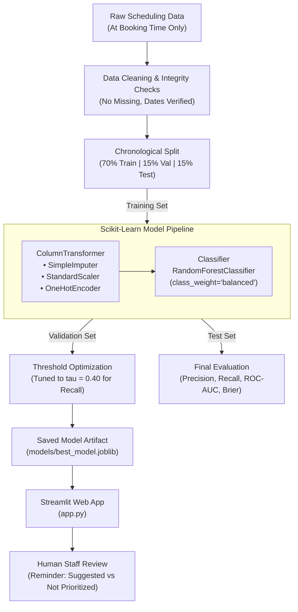

# 🏥 Hospital Appointment No-Show Prediction
### Machine Learning-Based Appointment Reminder Support System
**Internship Assessment:** ALGIONS AI LABS PRIVATE LIMITED  
**Role:** AI & Machine Learning Intern  
**Academic Level:** Final-Year B.Tech Computer Science & Engineering (Specialization: Data Science / Machine Learning)  

---

## 1. Problem Statement
In outpatient hospital clinics, missed appointments ("no-shows") result in wasted physician hours, underutilized diagnostic equipment, longer patient waiting lists, and lost hospital revenue. Conversely, manually calling every single scheduled patient to confirm attendance requires excessive administrative staff hours.

## 2. Project Objective
Build a lightweight, interpretable, end-to-end Machine Learning decision-support system that predicts the probability of a patient missing a booked appointment. 

**Critical Boundary:** This tool is strictly an administrative support system. It **never** predicts medical diagnosis, clinical urgency, triage status, or medical outcomes. All suggested reminders must be reviewed and confirmed by human hospital staff.

---

## 3. System Architecture



---

## 4. Technologies Used
- **Programming Language:** Python 3.13 / 3.10+
- **Data Manipulation:** Pandas, NumPy
- **Machine Learning & Preprocessing:** Scikit-learn (ColumnTransformer, Pipeline, DummyClassifier, LogisticRegression, RandomForestClassifier)
- **Model Serialization:** Joblib
- **Visualization:** Matplotlib, Seaborn
- **Inference User Interface:** Streamlit
- **Automated Testing:** Pytest

---

## 5. Dataset Explanation
To safeguard patient confidentiality (HIPAA/GDPR compliance) and avoid sensitive clinical identifiers, a reproducible synthetic dataset of **3,500 records** is generated with seed `42`.

### Features Available at Booking Time:
- `appointment_id`: Unique booking identifier (e.g. `APT-10001`, excluded from modeling).
- `booking_date`: Date the appointment was reserved.
- `appointment_date`: Date scheduled for the hospital visit.
- `lead_time_days`: Calculated advance booking window ($appointment\_date - booking\_date \ge 0$).
- `age_group`: Patient age category (`Young Adults (18-35)`, `Middle-Aged (36-55)`, `Older Adults (56-70)`, `Seniors (71+)`).
- `department`: Clinic department (`General Medicine`, `Cardiology`, `Orthopedics`, `Dermatology`, `Pediatrics`, `Ophthalmology`).
- `appointment_type`: Visit category (`Routine Checkup`, `Follow-up`, `Specialist Consultation`, `Diagnostic / Lab`).
- `booking_channel`: Medium of scheduling (`Online Portal`, `Phone Call`, `In-Person`, `Mobile App`).
- `previous_appointments`: Historical number of completed or scheduled appointments prior to this booking.
- `previous_no_shows`: Historical missed appointments prior to this booking ($\le previous\_appointments$).
- `sms_opt_in`: Whether the patient agreed to receive text alerts (`1 = Yes`, `0 = No`).
- `no_show`: Target variable (`0 = Attended`, `1 = Missed`).

---

## 6. Project Folder Structure

```
hospital-no-show-prediction/
│
├── app.py                     # Streamlit web application interface
├── generate_data.py           # Reproducible synthetic dataset generator (seed=42)
├── train_model.py             # Preprocessing pipeline, model training, chronological evaluation
├── evaluate_model.py          # Standalone evaluation & diagnostic chart generation
├── requirements.txt           # Python dependencies
├── README.md                  # Comprehensive project documentation
├── VIVA_GUIDE.md              # 30 Technical Viva Q&As + Hinglish explanations
├── .gitignore                 # Standard Python ignore rules
│
├── data/
│   └── appointments.csv       # 3,500 generated appointment records
│
├── models/
│   └── best_model.joblib      # Saved preprocessor + Random Forest pipeline & threshold metadata
│
├── notebooks/
│   ├── eda.ipynb              # Interactive Jupyter Notebook for EDA
│   └── run_eda.py             # Script to generate EDA charts
│
├── reports/
│   ├── technical_report.md    # Comprehensive academic-style technical report
│   ├── model_results.csv      # Benchmarked test and validation metrics
│   └── figures/               # 8 generated high-resolution diagnostic plots
│       ├── 01_target_distribution.png
│       ├── 02_noshow_by_department.png
│       ├── 03_noshow_by_age_group.png
│       ├── 04_lead_time_vs_noshow.png
│       ├── 05_previous_noshows_vs_noshow.png
│       ├── 06_confusion_matrix.png
│       ├── 07_roc_curve.png
│       └── 08_calibration_curve.png
│
└── tests/
    └── test_pipeline.py       # 8 unit and integration tests passing with Pytest
```

---

## 7. Step-by-Step Installation & Execution Guide

All commands are tailored for **Windows PowerShell** in VS Code.

### Step 1: Open Terminal in Project Directory
```powershell
cd "D:\Aiml project\hospital-no-show-prediction"
```

### Step 2: Install Required Dependencies
```powershell
pip install -r requirements.txt
```

### Step 3: Generate the Dataset (Seed = 42)
```powershell
python generate_data.py
```
*Creates `data/appointments.csv` containing 3,500 records.*

### Step 4: Run Exploratory Data Analysis & Generate Visualizations
```powershell
python notebooks/run_eda.py
```
*Generates `notebooks/eda.ipynb` and saves 5 diagnostic plots in `reports/figures/`.*

### Step 5: Train Models & Select Operating Threshold
```powershell
python train_model.py
```
*Trains Baseline, Logistic Regression, and Random Forest; performs chronological validation; optimizes threshold; saves `models/best_model.joblib` and `reports/model_results.csv`.*

### Step 6: Run Standalone Evaluation & Generate Diagnostic Charts
```powershell
python evaluate_model.py
```
*Plots Confusion Matrix, ROC Curve, and Probability Calibration Curve in `reports/figures/`.*

### Step 7: Run Pytest Verification Suite
```powershell
pytest tests/test_pipeline.py -v
```
*Executes all 8 unit and integration tests (expected: 8 passed).*

### Step 8: Launch the Streamlit Web Application
```powershell
streamlit run app.py
```
*Opens the interactive web application at `http://localhost:8501`.*

---

## 8. Actual Evaluation Results

Results evaluated on the **Held-Out Test Set** (525 unseen future records: 389 attended, 136 no-shows):

| Model Name | Operating Threshold | Accuracy | Precision | Recall (Sensitivity) | F1-Score | ROC-AUC | Brier Score |
| :--- | :--- | :--- | :--- | :--- | :--- | :--- | :--- |
| **Dummy Baseline** | 0.50 | 74.1% | 0.0% | 0.0% | 0.0000 | 0.500 | 0.1921 |
| **Logistic Regression** | 0.50 | 67.4% | 40.2% | 52.9% | 0.4571 | **0.696** | 0.2164 |
| **Random Forest (Best)** | **0.40** | 58.5% | 36.2% | **78.7%** | **0.4954** | 0.693 | **0.2087** |

### Confusion Matrix on Test Set (Random Forest, $\tau = 0.40$):
- **True Negatives (TN):** 200 (Attended patients correctly not prioritized)
- **False Positives (FP):** 189 (Attended patients who received an extra reminder call)
- **False Negatives (FN):** 29 (Missed no-shows)
- **True Positives (TP):** **107 (Missed appointments successfully caught out of 136 = 78.7% Recall)**

### Why We Selected Threshold $\tau = 0.40$:
In healthcare operations, the cost of a **False Negative** (a doctor sitting idle for 45 minutes) is far higher than a **False Positive** (a receptionist making a 30-second reminder call). By setting the threshold to 0.40 on validation data, our recall surged from 53.2% to **78.7%**, catching **107 out of 136 no-shows**.

---

## 9. Streamlit Application Walkthrough & Screenshots
The web application provides three structured sections:

1. **Section A: Home / Overview:**
   - Displays project scope, technical specifications, and a permanent clinical safety disclaimer.
2. **Section B: Prediction (Interactive Decision Support):**
   - Front-desk staff enter appointment schedule, patient history, and department.
   - Lead time is calculated automatically in real time.
   - System outputs the predicted probability (e.g. `64.2%`) and decision recommendation:
     - ⚠️ `Reminder Review: Suggested` (if $\ge 40\%$)
     - ✅ `Reminder Review: Not Prioritized` (if $< 40\%$)
   - Contextual signals highlight why the score is high (e.g., long lead time, history of missed visits).
3. **Section C: Model Performance:**
   - Displays real benchmark tables, interactive confusion matrix, ROC curve, and operational error cost explanations.

---

## 10. Limitations & Responsible AI Guidelines
- **Synthetic Data Disclaimer:** The model was trained on synthetic data representing clinical operational hypotheses. It must be retrained on real local Electronic Health Records (EHR) before live clinical deployment.
- **Human-in-the-Loop Requirement:** The system is an advisory tool. It **must never** automatically cancel appointments or deny healthcare access to patients.
- **Fairness & Bias:** Protected clinical variables (race, medical conditions, financial status) were deliberately excluded to prevent algorithmic discrimination.

---

## 11. Future Scope
- Integration with hospital WhatsApp Business API for automated 24-hour reminder triggers.
- Dynamic overbooking algorithms that recommend overbooking only when no-show risk is high.
- Integration with local weather API to capture heavy rainfall or transport disruption signals at appointment time.

